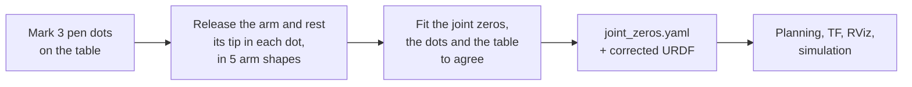

<h1 align="center">calib-kit</h1>

<p align="center">
  <b>A toolkit for robot calibration.</b><br/>
  Measured with the robot itself, written where the rest of your stack already looks.
</p>

<p align="center">
  <a href="https://github.com/Yadunund/calib-kit/actions/workflows/ci.yml"></a>
  <a href="LICENSE"></a>
  
  <a href="https://pixi.sh"></a>
</p>

---

Most robots ship slightly wrong. Encoders are zeroed by eye, parts are printed a little off, and
the description the whole stack plans with is an idealised drawing of the robot rather than the
robot itself. calib-kit closes that gap, one calibration at a time.

- **The robot is the instrument.** Calibrations use the robot's own sensors and as little else as
  possible: no fiducials, no measuring jigs, often just a pen.
- **The result goes where your stack already looks.** A corrected URDF, so planning, TF,
  visualisation and simulation all see the robot as it is, with no new runtime component.
- **No robot-specific code.** A robot takes part through the ROS 2 interfaces its stack already
  has. Supporting a new one means writing a short profile of data.
- **Every number has an error bar.** Each fitted value comes with its uncertainty, and anything the
  measurements could not pin down is named rather than guessed.

## Calibrations

| Package | Calibrates | You need | Time |
|---|---|---|---|
| [**`arm_calibration`**](arm_calibration/README.md) | An arm's joint zero offsets against its URDF | A pen and a flat table | About 5 minutes |

## `arm_calibration` at a glance

Encoders zeroed by eye leave each joint a degree or a few off the angle the URDF means; at a 30 cm
reach, one degree at the shoulder moves the tip about 5 mm. `arm_calibration` measures those
offsets by touching a few pen dots on the table, and folds them into the URDF.



```bash
# 1. With the arm's ros2_control stack running, clamp it flat to a table and mark three dots.
# 2. Touch each dot in five shapes, as the tool asks:
ros2 run arm_calibration calibrate_zeros --profile so101 --out ~/arm_zeros
# 3. Use ~/arm_zeros/so101_calibrated.urdf as the robot description.
```

It reports each zero with its uncertainty, and why any joint is held:

```text
15 touches on 3 dots; the closed jaw tips 0.63 mm rms from their dots after the fit.
  shoulder_lift_joint       +1.73 deg  (+- 0.36)
  elbow_flex_joint          -2.63 deg  (+- 0.49)
  wrist_flex_joint          +3.17 deg  (+- 0.39)
  shoulder_pan_joint       held: its axis is the table's normal through the base, so turning it turns every dot with it
  wrist_roll_joint         held: its axis passes almost through the closed tips, so turning it barely moves them
  the closed jaw tips at [0.3 0.  6.3] mm in gripper_frame_link
```

**Works with any ros2_control arm.** The tool reads `/robot_description` and `/joint_states`, and
releases the arm through the controller manager by taking its `<ros2_control>` hardware inactive.
It restores the controllers it stopped however the run ends. The
[contract](arm_calibration/README.md#contract) states exactly what it needs and what it guarantees.

| Arm | Profile |
|---|---|
| SO-ARM101 | [`so101`](arm_calibration/arm_calibration/arms/so101.yaml) |

Adding an arm is a YAML profile: its base and tip links, which zeros to fit, and where the tip is.
See [Arms](arm_calibration/README.md#arms).

## Getting started

Each package is a ROS 2 package. Clone calib-kit into a workspace and build it with colcon:

```bash
cd ~/ws/src && git clone https://github.com/Yadunund/calib-kit.git
cd ~/ws && colcon build --packages-up-to arm_calibration && source install/setup.bash
```

Or work on calib-kit itself with [pixi](https://pixi.sh), which brings a ROS 2 environment with
everything the packages and their tests need. CI runs the same tasks:

```bash
pixi run lint
pixi run build
pixi run test
```

## Contributing

New calibrations are welcome. Each one is its own package in this repository, and follows the
same rules: it measures with the robot itself, writes its result where the stack already looks,
and states the ROS interfaces it needs as a contract in its README.

## Licence

[Apache-2.0](LICENSE).
